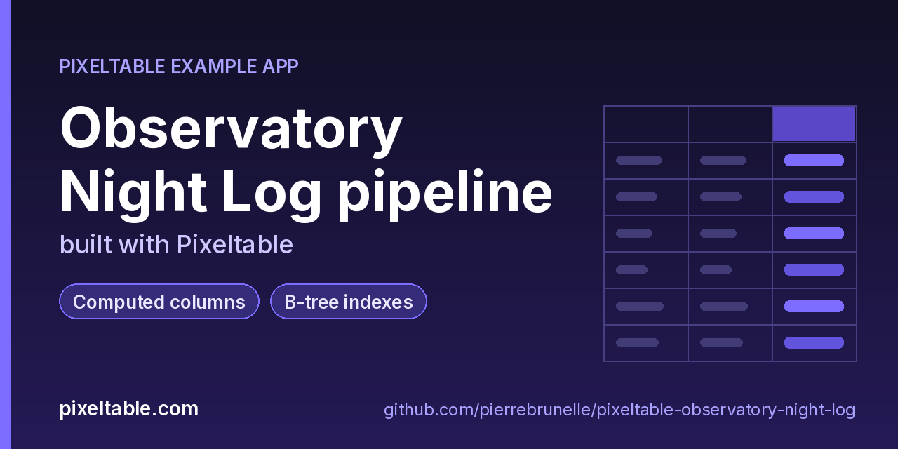

<!-- pixeltable-example-app: 20261026-observatory-night-log -->
# Observatory Night Log pipeline built with Pixeltable



[](https://codespaces.new/pierrebrunelle/pixeltable-observatory-night-log?quickstart=1)
[](https://pixeltable.com)
[](https://pypi.org/project/pixeltable/)
[](https://github.com/pixeltable/pixeltable)
[](LICENSE)

`Observations` holds one logged exposure per row (`obs_id` primary key, night, observer, target, sexagesimal `ra_hms` / `dec_dms`, band, exposure, airmass and a semicolon-separated `mags_raw`). Computed columns parse the legacy strings with UDFs (`parse_ra`, `parse_dec`, `parse_mags` returning a float array), take `mags[0]` and `pixeltable.functions.array.to_list`, compute JSON photometry stats (`mag_stats`), the mean magnitude (`stats['mean']`), altitude from airmass and a flux rate. `Clean` is a view of the rows that parsed end to end, with a `scatter` column, and B-tree indexes on `night` and `target` back the `night_summary` and `target_light_curve` queries. `pipeline.py` (argparse, no server) runs the migration: `archive` keeps the raw rows with `pxt.io.import_rows`, `migrate` inserts every CSV row with `insert(rows, on_error='ignore')`, `errors` lists failed cells per column from `errortype` / `errormsg`, `fix` applies a corrections file with `batch_update` (only the failed cells recompute), `report` prints per-night summaries and a light curve, and `export` writes the clean view to CSV.

[Pixeltable](https://pixeltable.com) is open-source, Python-native **multimodal AI data infrastructure**: tables, incremental computed columns, UDFs, indexes and serving in one library, running locally or on Pixeltable Cloud.

> ⭐ **Like this example?** Star [pixeltable/pixeltable](https://github.com/pixeltable/pixeltable) on GitHub. It helps other developers find it.

## What this example shows

- **Incremental computed columns** powered by plain Python UDFs (`@pxt.udf`)
- **B-tree indexes** declared on the model (`__indexes__`) back the lookup queries
- **Importable UDF module**: UDFs live in `udfs.py`; tables and queries live in `app.py` (Pixeltable resolves UDFs by module path)
- **`pixeltable.toml`** declares a local database and a **Pixeltable Cloud** database, so the same code deploys with `pxt db update`

## Error handling at a glance

| Need | Python | CLI |
|---|---|---|
| Insert everything, keep failures | `t.insert(rows, on_error='ignore')` | |
| Which cells failed, and why | `t.where(t.ra_deg.errortype != None).select(t.obs_id, t.ra_deg.errortype, t.ra_deg.errormsg)` | `pxt errors observatory/observations` |
| Fix source values in bulk | `t.batch_update([{'obs_id': ..., 'ra_hms': ...}, ...])` | |
| Recompute a column | | `pxt recompute observatory/observations mean_mag -f` |
| Only the good rows | the `Clean` view (`where(rate != None)`) | `pxt count observatory/clean` |

## Notes

- A failed computed cell does not fail its row: the row is stored, the cell is `None`, and the column's `errortype` / `errormsg` say why. Columns that depend on it fail too, so `rate` reports errors from `mean_mag`, `ra_deg` and friends.
- Read JSON keys with brackets: `stats['mean']`. `stats.mean` resolves to the expression method `mean`, not the JSON key, and the same goes for other keys named like expression methods (`count`, `min`, `max`, `sum`, `len`, `keys`, `values`, `items`).
- `pxt.io.import_rows` keeps an untouched copy of the raw CSV rows next to the parsed table, so a migration can always be re-run from the source.

## What's inside

| File | What it is |
|------|------------|
| `.devcontainer/devcontainer.json` | GitHub Codespaces / Dev Container config: Python 3.12, installs `requirements.txt` |
| `.github/social-preview.png` | Social preview image (1280x640) |
| `CITATION.cff` | Citation metadata (authors, license, release date, keywords) |
| `app.py` | Tables declared as Python classes and `@pxt.query` functions |
| `data/corrections.csv` | Sample data |
| `data/night_log.csv` | Sample data |
| `pipeline.py` | Batch migration of a legacy observatory night log into Pixeltable (no server) |
| `pixeltable.toml` | Project config: the local database plus a Pixeltable Cloud database (sizing, deploy excludes) |
| `udfs.py` | Pixeltable UDFs (`@pxt.udf`) in their own importable module, imported by `app.py` |
| `requirements.txt` / `pyproject.toml` | Dependencies (`pixeltable>=0.7.20`) |

**Tables**

| Table | Stored columns | Computed columns |
|-------|---------|------------------|
| `observations` | `obs_id`, `night`, `observer`, `target`, `ra_hms`, `dec_dms`, `band`, `exposure_s`, `airmass`, `mags_raw` | `ra_deg`, `dec_deg`, `mags`, `mag_list`, `stats`, `mean_mag`, `altitude`, `rate` |
| `clean` | - | `scatter` |

## Run in your browser (GitHub Codespaces)

[](https://codespaces.new/pierrebrunelle/pixeltable-observatory-night-log?quickstart=1)

1. Click **Open in GitHub Codespaces** above (or [this link](https://codespaces.new/pierrebrunelle/pixeltable-observatory-night-log?quickstart=1)). The dev container installs Python 3.12 and `pixeltable>=0.7.20` from `requirements.txt`.
2. In the codespace terminal, create the tables, seed them and run the app:

   ```bash
   pxt schema update app.py observatory
   python pipeline.py generate              # deterministic sample: data/night_log.csv (240 exposures, 6 nights, some legacy typos)
   python pipeline.py archive               # keep the raw rows untouched with pxt.io.import_rows
   python pipeline.py migrate               # insert(rows, on_error='ignore'): every row lands, failed parses keep their error
   python pipeline.py errors                # failed cells per column: errortype + errormsg
   pxt errors observatory/observations      # the same from the CLI
   python pipeline.py fix                   # batch_update with data/corrections.csv; only the failed cells recompute
   python pipeline.py report                # per-night summary + Algol light curve
   python pipeline.py export                # Clean view -> output/clean_observations.csv
   pxt history observatory/observations     # every step above is a table version
   ```


## Quickstart

Requires Python 3.11+ and `pixeltable>=0.7.20`.

```bash
git clone https://github.com/pierrebrunelle/pixeltable-observatory-night-log.git
cd pixeltable-observatory-night-log
python -m venv .venv && source .venv/bin/activate
pip install -r requirements.txt

# Create the tables in a local catalog directory named `observatory`
pxt schema update app.py observatory

python pipeline.py generate              # deterministic sample: data/night_log.csv (240 exposures, 6 nights, some legacy typos)
python pipeline.py archive               # keep the raw rows untouched with pxt.io.import_rows
python pipeline.py migrate               # insert(rows, on_error='ignore'): every row lands, failed parses keep their error
python pipeline.py errors                # failed cells per column: errortype + errormsg
pxt errors observatory/observations      # the same from the CLI
python pipeline.py fix                   # batch_update with data/corrections.csv; only the failed cells recompute
python pipeline.py report                # per-night summary + Algol light curve
python pipeline.py export                # Clean view -> output/clean_observations.csv
pxt history observatory/observations     # every step above is a table version
```

## Deploy to Pixeltable Cloud

The same `app.py` runs on [Pixeltable Cloud](https://pixeltable.com). Sign in (or get a free trial database with `pxt new`), point the second database entry in `pixeltable.toml` at your own database, then deploy:

```bash
pxt login                       # or: export PIXELTABLE_API_KEY=<your-api-key>
# edit pixeltable.toml: name = 'pxt://<your-org>:<your-db>'
pxt db update pxt://<your-org>:<your-db>                 # build the image and upload the project
pxt schema update app.py pxt://<your-org>:<your-db>       # create the tables at the database root (no per-app folder)
```

Keep keys in environment variables or `pxt secret set`, never in code.

## Code walkthrough

**1. Business logic is plain Python, in `udfs.py`.** A `@pxt.udf` function can be used as a column expression. Pixeltable records UDFs by module path (`udfs.parse_ra`), so they live in their own importable module rather than inline in the app: the daemon, serving workers and Pixeltable Cloud import it again by that path.

```python
# udfs.py
@pxt.udf
def parse_ra(ra_hms: str) -> float:
    """'05:35:17.3' (hours:minutes:seconds) -> right ascension in degrees."""
    h, m, s = (float(p) for p in ra_hms.strip().split(':'))
    if not (0 <= h < 24 and 0 <= m < 60 and 0 <= s < 60):
        raise ValueError(f'RA out of range: {ra_hms!r}')
    return round(15.0 * (h + m / 60 + s / 3600), 5)
```

**2. Tables are Python classes (`app.py`).** Annotated attributes are stored columns; attributes assigned an expression are **computed columns** (`ra_deg`, `dec_deg`, `mags`, `mag_list`, `stats`, `mean_mag`, `altitude`, `rate`), evaluated incrementally on every insert or update and recomputed when their inputs change. Indexes live next to the columns.

```python
# app.py
class Observations(TableModel, name='observations'):
    """One logged exposure from the legacy night log, parsed by computed columns."""

    obs_id = pxt.Column(type=pxt.String, primary_key=True)
    night: pxt.String
    observer: pxt.String
    target: pxt.String
    ra_hms: pxt.String
    dec_dms: pxt.String
    band: pxt.String
    exposure_s: pxt.Float
    airmass: pxt.Float
    mags_raw: pxt.String

    ra_deg = parse_ra(ra_hms)
    dec_deg = parse_dec(dec_dms)
    mags = parse_mags(mags_raw)
    first_mag = mags[0]
    mag_list = pxt_array.to_list(mags)
    stats = mag_stats(mags)
    mean_mag = stats['mean'].astype(pxt.Float)  # bracket access: `stats.mean` would be the Expr method, not the JSON key
    altitude = altitude_deg(airmass)
    rate = flux_rate(mean_mag, exposure_s)

    __indexes__ = [pxt.BtreeIndex(night), pxt.BtreeIndex(target)]
```

**3. Queries are functions (`app.py`).** `@pxt.query` wraps a Pixeltable query so it can be called from Python or exposed as a route:

```python
# app.py
@pxt.query
def night_summary(night: str):
    """Every parsed exposure of one night, brightest first."""
    return (
        Observations.where((Observations.night == night) & (Observations.rate != None))
        .order_by(Observations.mean_mag)
        .select(Observations.obs_id, Observations.target, Observations.band, Observations.mean_mag,
                Observations.altitude, Observations.rate)
    )
```

## Learn more

- 🌐 Website: https://pixeltable.com
- 📚 Docs: https://docs.pixeltable.com
- 💻 Source: https://github.com/pixeltable/pixeltable (⭐ star it if Pixeltable is useful to you)
- 📦 PyPI: https://pypi.org/project/pixeltable/
- 🧩 More example apps: https://pierrebrunelle.github.io/awesome-pixeltable-apps/

**[More Pixeltable example apps →](https://pierrebrunelle.github.io/awesome-pixeltable-apps/)**

---

<sub>Built as part of a daily series of Pixeltable example apps · Pixeltable 0.7.20 · Python, incremental computed columns · Licensed under Apache-2.0.</sub>
